# Practica #2 Grupo #9

## UNIVERSIDAD DE SAN CARLOS DE GUATEMALA
## 0964 ORGANIZACION COMPUTACIONAL/1S_2026
## Catedrático: Ing. FERNANDO JOSÉ PAZ GONZÁLEZ
## Tutor auxiliar: RONY OMAR MIGUEL LÓPEZ 
## Seccion: C
#
## Dina Rebeca Pérez Batres 202308200
## Astrid Vanesa Kim Ortiz 202300685
## Angel Jose Cardenas Pocon 202304063
## Oliverio Abraham Caal Artola 202303864

### GUATEMALA, 21 DE MARZO DEL 2,026
#
## INTRODUCCION:
El proposito de esta practica grupal fue el desafiarnos en realizar en pocos términos, una calculadora con una unidad logica y cientifica donde se tuvieron los desafios de realizarla en formato digital y en fisico, probandolo en protoboards y placas. Este documento Markdown tiene el propósito de dar a extender el trabajo grupal que se lleov a realizar y la colaboraicon de cada integrante del grupo. 

## DESCRIPCION DEL PROBLEMA
El problema central es el diseñar y construir un circuito combinacional capaz de realizar operaciones aritméticas, lógicas y comparativas con números binarios de 4 bits. Para ello, implementamos diferentes módulos que incluyen una unidad aritmética para operaciones aritméticas como suma, resta, potencia y multiplicación; una unidad lógica con operaciones como AND, OR y XNOR; y por ultimo, una unidad comparativa que muestre el número mayor y menor en un display. Además, se requiere un controlador que nos permita seleccionar las operaciones deseadas y un sistema de visualización con displays de 7 segmentos y LEDs. La implementación la realizamos tanto en una simulación dentro de Proteus como físicamente, utilizando protoboards para la mayor parte de las operaciones de unidad logica y aritmetica, como placas para la unidad aritmetica de resta y logica. 
Cabe destacar que se tomo en cuenta la lectura de los documentos necesarios para la realización y solución del problema. 

#
## Diagramas de los diseños desarrollados
Unidad Logica
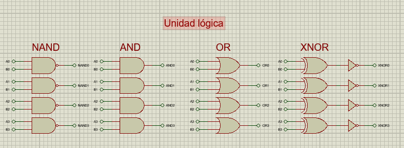
Selector de operaciones
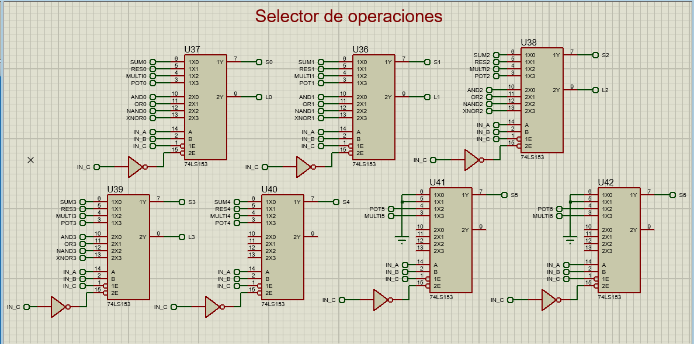
Salida
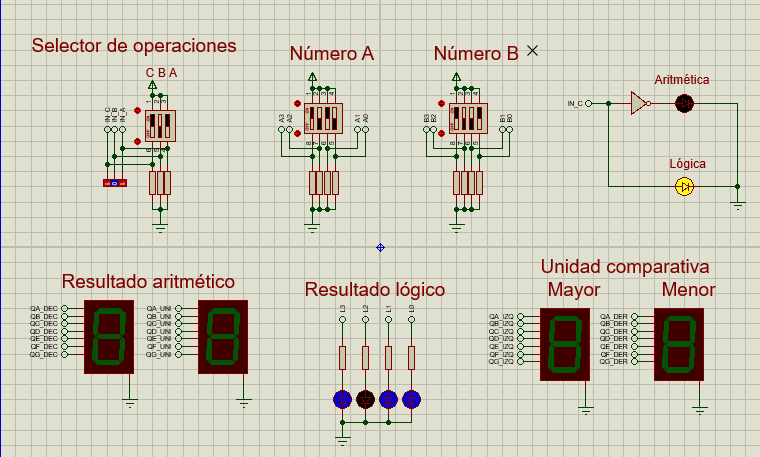

Diagrama de Potencia al cuadrado y al cubo
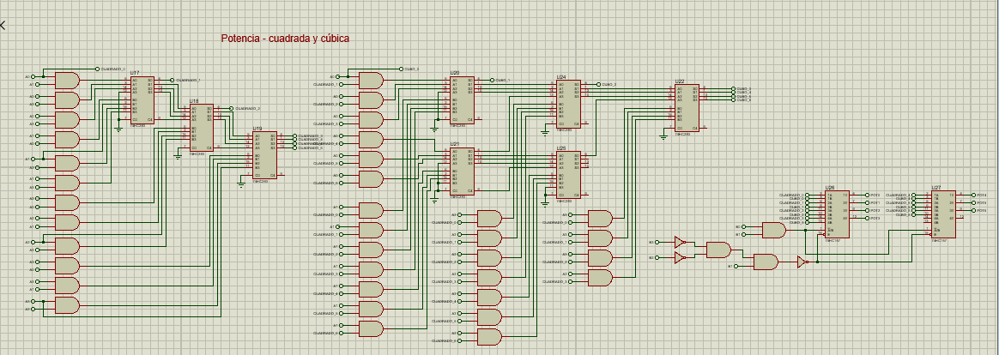

Unidad comparativa
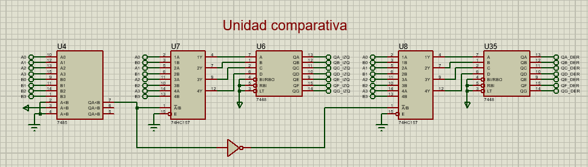

Multiplicador de 2 numeros a 4 bits
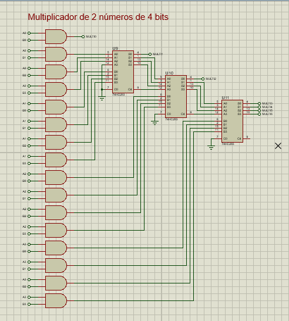

Restador de 2 numeros a 4 bits
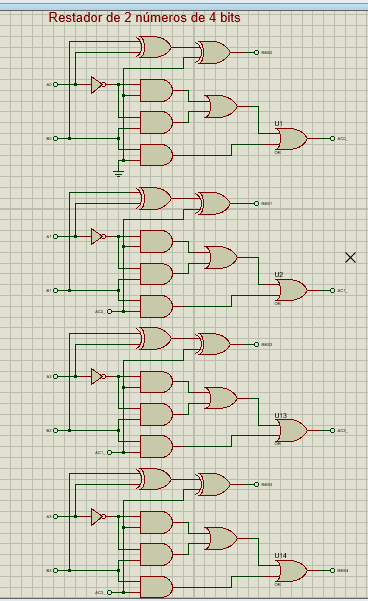
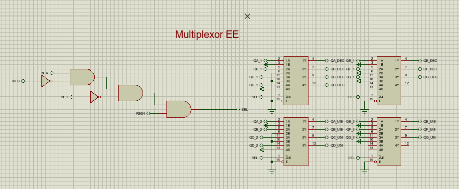

Sumador de 2 numeros a 4 bits
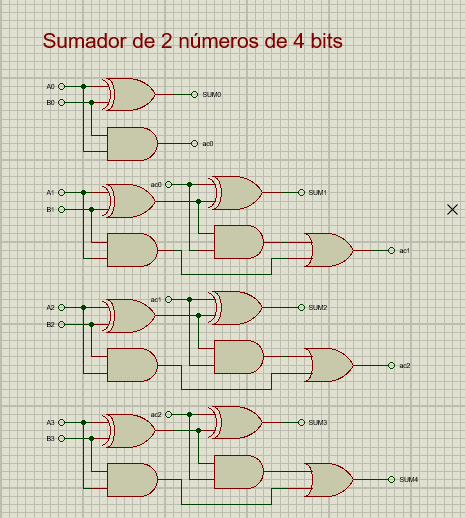

#

#
## Equipo Utilizado
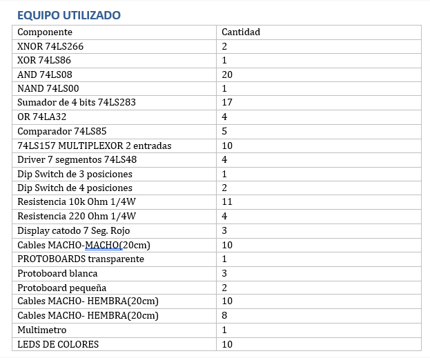

#
## Presupuesto
### Gastos
Cada integrante del grupo dio equitativamente el presupuesto que se gasto en la realización de esta 2nda Practica. 
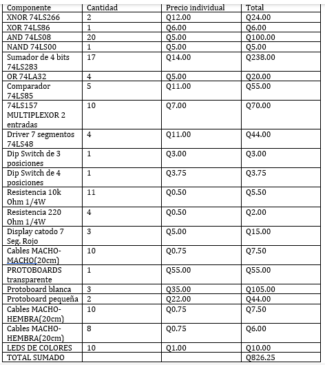

#
### Aporte de cada integrante
#
1. Oliverio Abraham Caal Artola: realización del circuito de la multiplicacion en protoboard, más la zona de resultados. 
2. Angel Jose Cardenas Pocon: manejo del presupuesto y realización del circuito del conversor de binario a bcd, más el selector de operaciones.
3. Dina Rebeca Pérez Batres: realización del circuito de la suma en protoboard. 
4. Astrid Vanesa Kim Ortiz: Realizacion del circuito de la suma en protoboard más la unidad comparativa

## Conclusiones
La práctica permitió aplicar conocimientos en el diseño y construcción de una "calculadora" con unidad lógica y científica, superando retos en su implementación digital y física. Se logró validar su funcionamiento en protoboards y placas, aunque surgieron dificultades. Este documento refleja el esfuerzo grupal, detallando el proceso y la contribución de cada integrante y su colaboración. 

### ANEXOS

MATERIALES A UTILIZAR

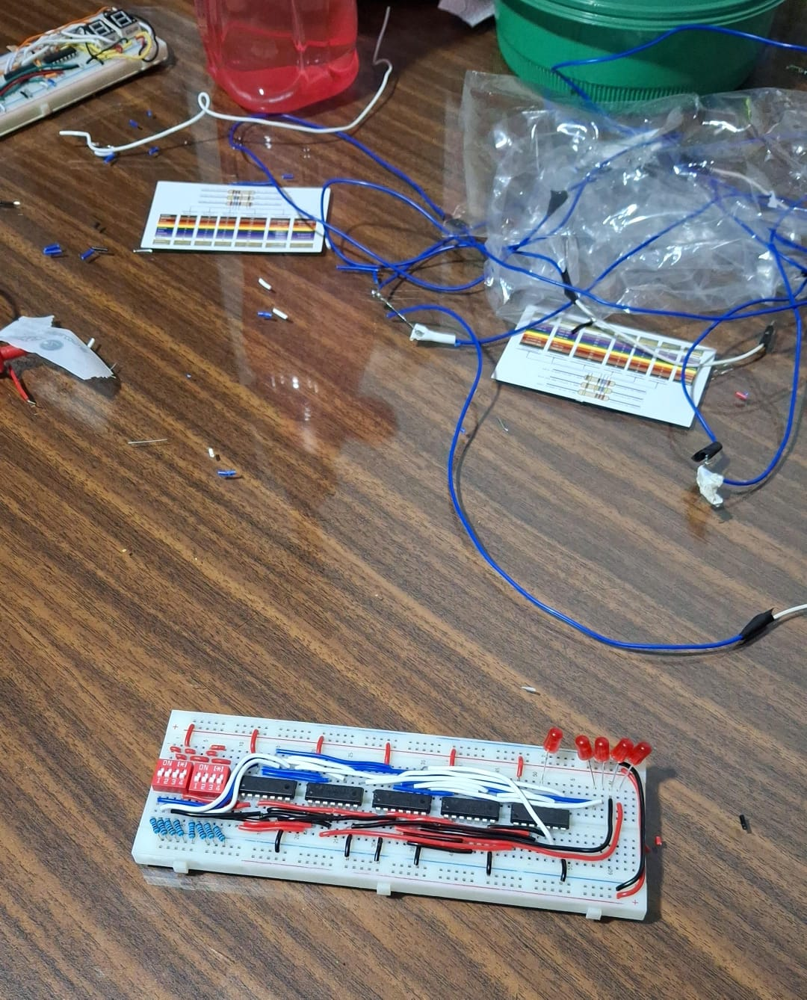

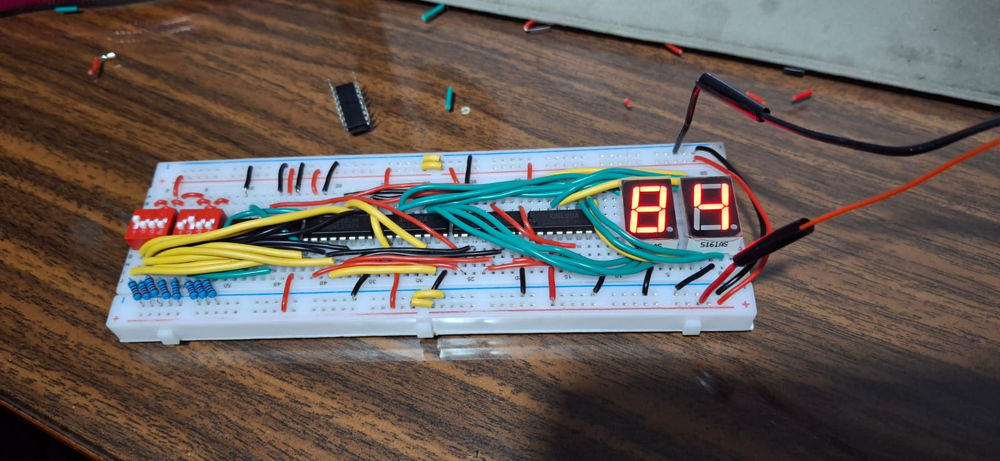
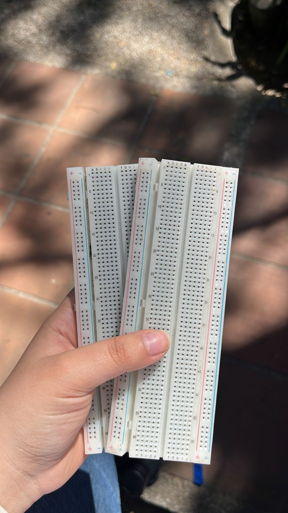
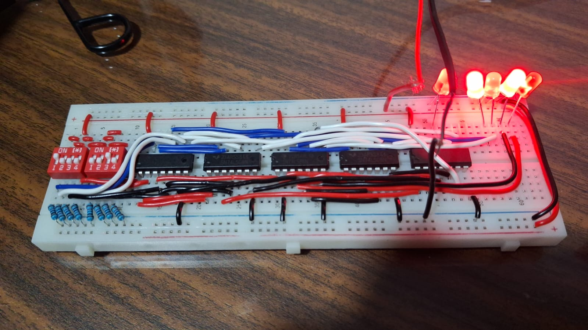

#
Suma
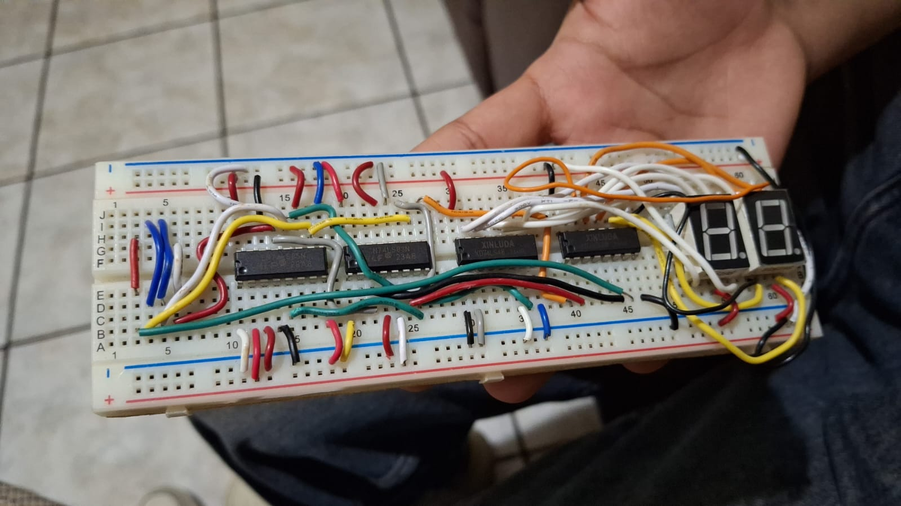
#
Resta
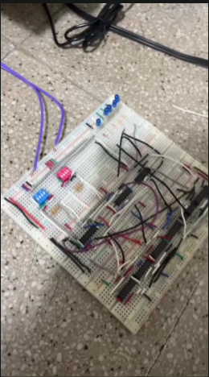
#
Conversor binario a BCD
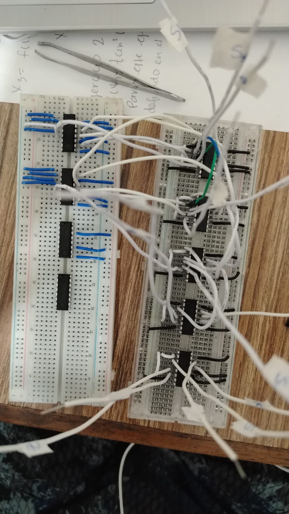
#
